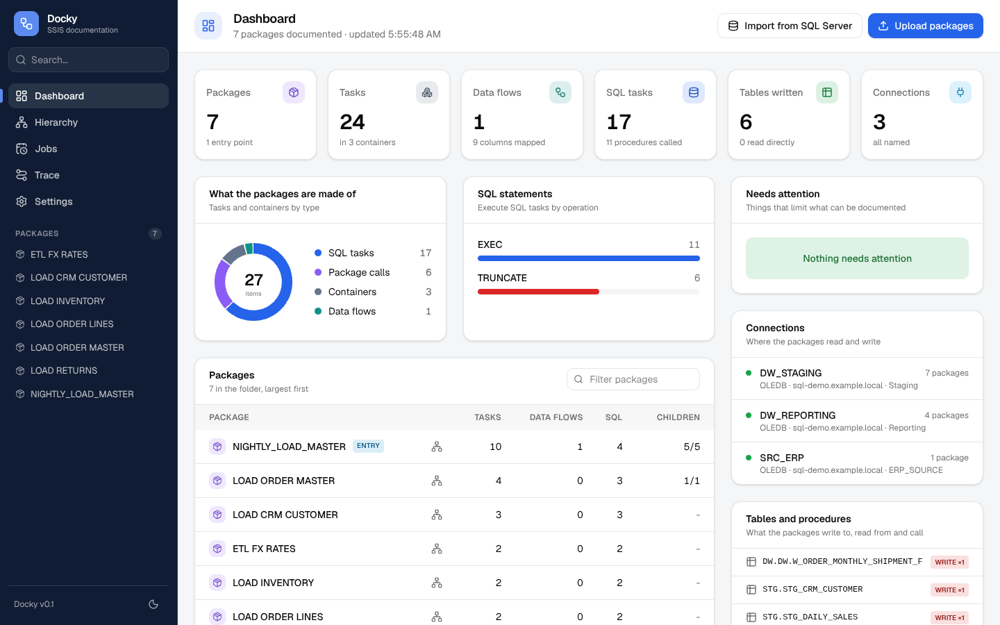
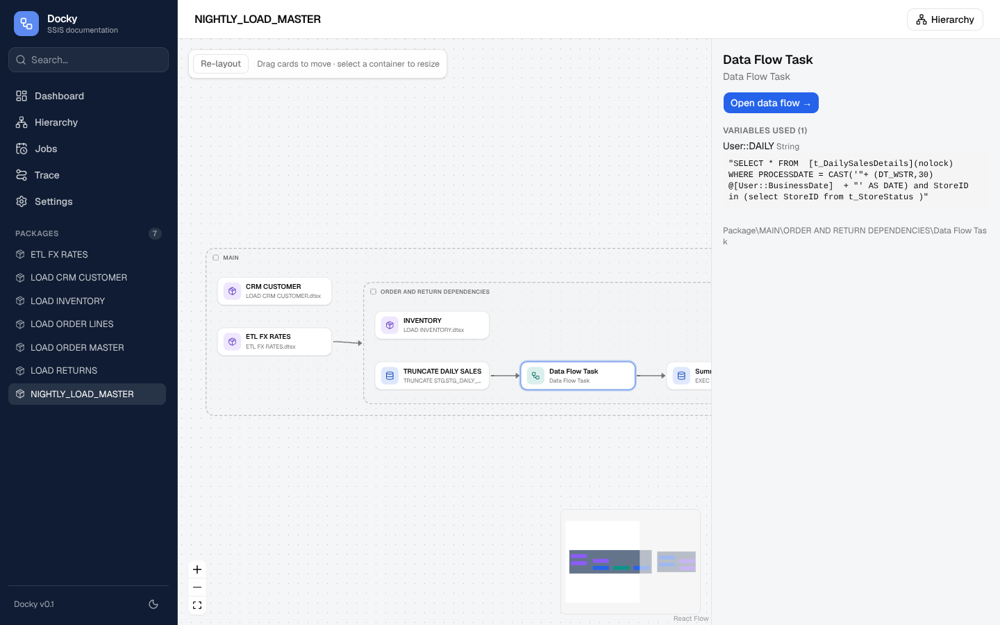
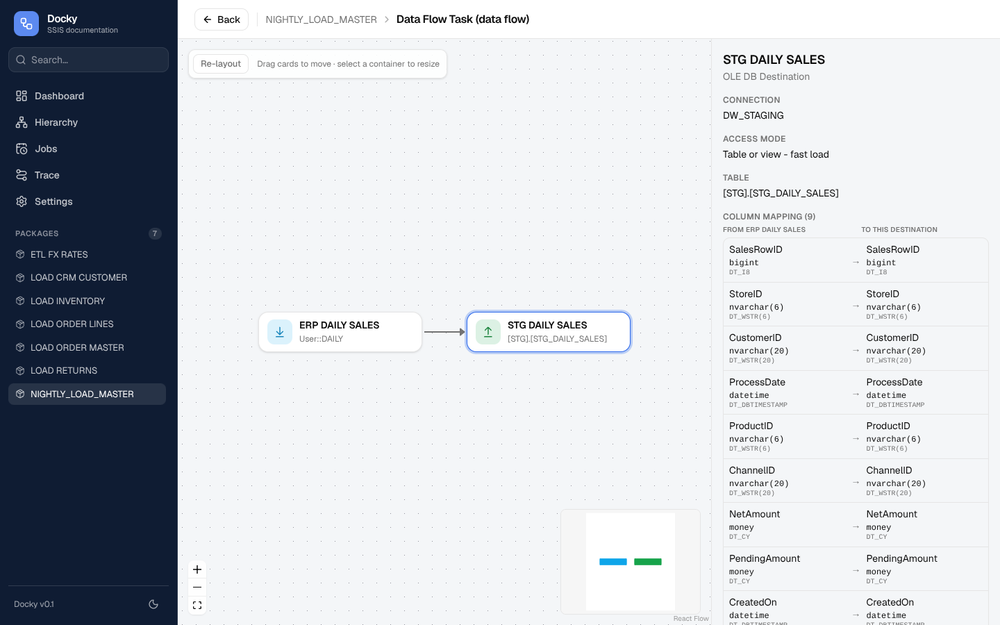
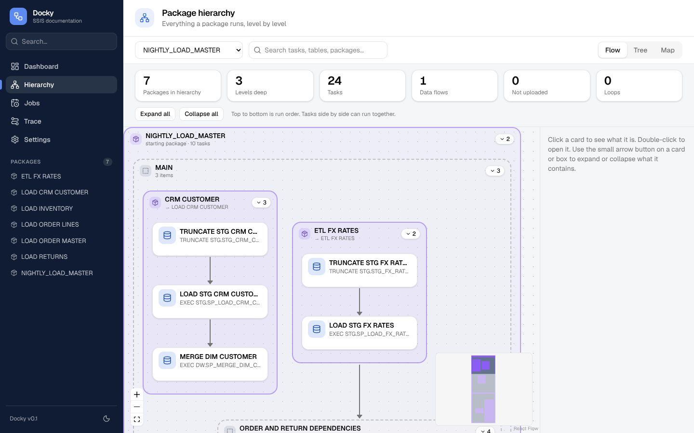
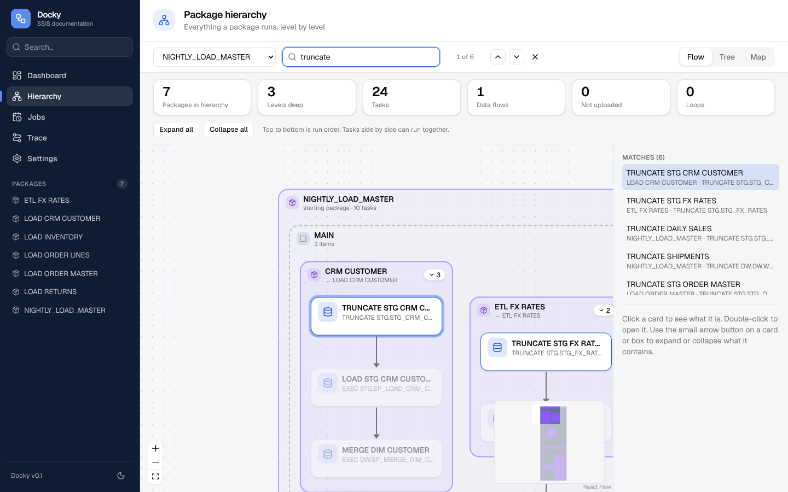
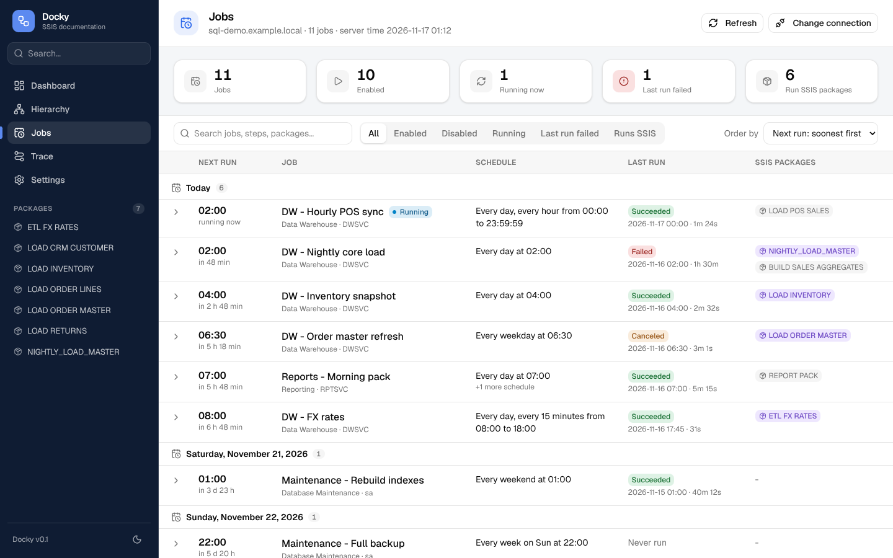
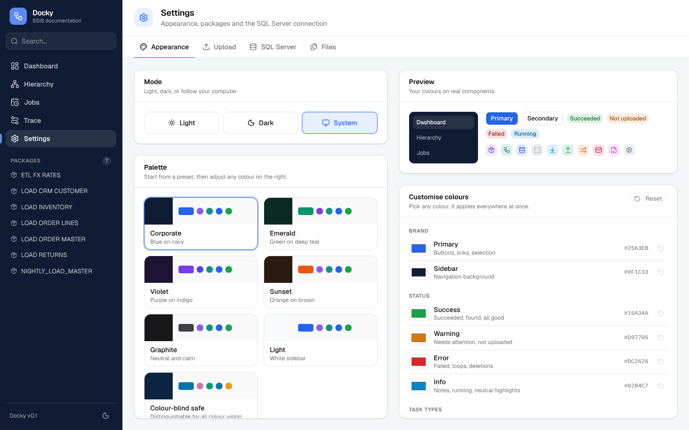
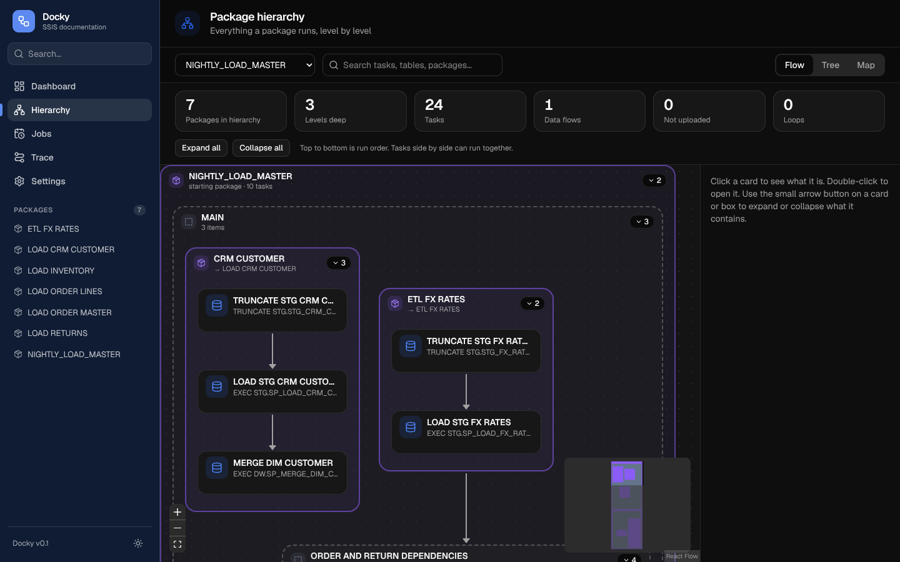
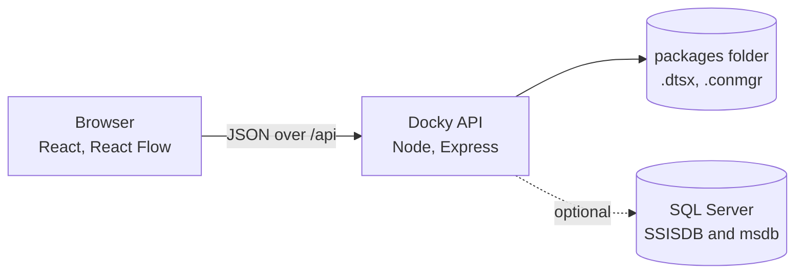

# Docky

**Browsable documentation for SSIS packages.** Docky reads your `.dtsx` files and turns them into an interactive map: control flow, data flow with column mappings, the full package hierarchy, and the SQL Server Agent jobs that run them. No SSIS or SQL Server install is needed to read packages.



> **Status: early.** The package parsing, dashboard, hierarchy, canvas and settings are working and have been run against real packages. The two features that talk to a live SQL Server (importing from the SSIS catalog, and the Agent jobs page) are implemented and their logic is unit-tested, but they have **not yet been verified against a real server**. Please open an issue if one misbehaves on yours.

## Contents

- [Features](#features)
- [Quick start](#quick-start)
- [How it works](#how-it-works)
- [Configuration](#configuration)
- [API](#api)
- [Project structure](#project-structure)
- [Security and privacy](#security-and-privacy)
- [Limitations](#limitations)
- [Roadmap](#roadmap)
- [Contributing](#contributing)
- [License](#license)

## Features

### Package canvas

Open any package and see its control flow as a diagram: tasks, sequence containers (as real nested boxes), and the precedence constraints between them (success, failure and completion are drawn differently). Click a task for its SQL, connection and child package. Drag cards and resize containers to tidy the layout; Docky remembers it per package in your browser.



### Data flow details

Click into a Data Flow Task to see its sources and destinations. Select a component for its **column mapping** with data types, shown as the SQL type with the SSIS type underneath, and a highlight wherever the type arriving differs from the destination column.



The panel also lists the **variables the component uses**. Variables nothing refers to are left out on purpose, and a variable used only by another unused variable's expression does not count.

### Package hierarchy

Pick a package and see everything it runs, level by level. Execute Package Tasks open as boxes holding the called package, down to any depth, with every task in **run order**: what runs first is on top, tasks that can run together sit side by side, and arrows follow the precedence constraints.



- **Three views:** Flow (top-down boxes), Tree (an outline with "after X" notes) and Map (each package once, with arrows between them).
- **Search the hierarchy:** names, SQL targets, tables and called packages. Matches are highlighted, everything else dims, the branches leading to them open, and you can step between matches.
- **Problems are flagged:** packages that are referenced but not uploaded, and packages that call one of their own ancestors (loops).



### SQL Server Agent jobs

Connect with a SQL login and see every Agent job **in the order it will run next**, grouped by day. Each job shows its schedule in words ("Every weekday at 06:30"), the last run and its outcome, and the SSIS packages its steps run, linked to the matching package in Docky. Filter by status, search, and re-order by time of day, name or last run.



*Screenshot uses sample data.*

### Dashboard

Totals across all packages, a breakdown by task type and SQL operation, the tables written and read, stored procedures called, connections, and a **Needs attention** list (child packages not uploaded, connections without a name, files that could not be read, columns whose type changes).

### Settings

- **Upload** `.dtsx` packages, `.conmgr` connection managers, or a whole `.ispac` project (unpacked into its packages and connections).
- **SQL Server:** browse the SSIS catalog (SSISDB) and import deployed projects.
- **Appearance:** light, dark or system, seven colour palettes (including a colour-blind-safe one), and every colour adjustable.
- **Files:** what is on the server, with delete.



Dark mode and every palette apply everywhere at once:



## Quick start

**Requirements:** Node.js 20.19+ or 22.12+ (Vite 8 needs it), and npm.

```bash
git clone https://github.com/ismael2314/docky-SSISExplorer.git docky
cd docky

# 1. The API (reads your packages)
cd server
npm install
npm start                # http://127.0.0.1:5000

# 2. The web app (in a second terminal, from the repo root)
npm install
npm run dev              # http://localhost:5173
```

Open <http://localhost:5173>. The dev server proxies `/api` to the API on port 5000.

### Try it with the sample packages

[`samples/`](samples) holds an invented, retail-themed project: a master package that calls five children (one of which calls another), a data flow, variables, a failure path, and three connection files. Every name in it is made up.

```bash
cp samples/* server/packages/
```

Or upload the files from **Settings, Upload**. Then open the **Hierarchy** page and choose `NIGHTLY_LOAD_MASTER`.

### Use your own packages

Put `.dtsx` files in `server/packages/` (or upload them in Settings). To give connections their names, add the project's `.conmgr` files too, or upload the project's `.ispac`. Child packages are matched by file name, so keep a master and its children in the same folder. `server/packages/` is git-ignored, so your own files are never committed.

### Command-line parsing

```bash
cd server
npm run parse -- packages/NIGHTLY_LOAD_MASTER.dtsx    # prints the parsed model as JSON
```

## How it works



- The **parser** (`server/dtsx.js`) reads package XML with `fast-xml-parser`. It is a pure function: XML in, a plain JSON model out. It extracts tasks and containers, precedence constraints, variables (and where each is used), connections, Execute SQL statements, data flow components and their column metadata.
- The **API** serves that model. It re-parses a file only when it changes on disk.
- The **web app** only talks to the API. The JSON shapes are the contract, so the backend can be replaced (an ASP.NET Core version is planned) without changing the front end.
- Nothing is sent anywhere except to your own API and, only if you use those features, to your SQL Server.

## Configuration

Environment variables for the API:

| Variable | Default | Purpose |
|---|---|---|
| `PORT` | `5000` | Port the API listens on |
| `HOST` | `127.0.0.1` | Address it listens on. Keep it local until there is authentication |
| `PACKAGES_DIR` | `server/packages` | Folder of `.dtsx` / `.conmgr` files |
| `DATA_DIR` | `server/data` | Where saved connection settings go (never the password) |
| `DOCKY_SQL_PASSWORD` | unset | Optional SQL password. With it set, the Jobs page opens without asking for one |

Appearance (mode, palette, custom colours) is stored in the browser.

## API

| Endpoint | What it does |
|---|---|
| `GET /api/dashboard` | Totals and breakdowns across all packages |
| `GET /api/packages` | Every package: id, stats, child packages (found or not), entry point |
| `GET /api/packages/:id` | Summary: variables (with where they are used), connections, stats |
| `GET /api/packages/:id/flow` | Control flow: nodes (with `parent` for containers) and edges |
| `GET /api/packages/:id/dataflow?task=<refId>` | A Data Flow Task's components, paths and column metadata |
| `GET /api/packages/:id/hierarchy` | Full call tree in run order, plus a package-level graph |
| `GET /api/files`, `PUT /api/files/:name`, `DELETE /api/files/:name` | List, upload (`.dtsx`, `.conmgr`, `.ispac`) and delete |
| `GET /api/connections` | Project connections from `.conmgr` files (passwords masked) |
| `GET/PUT /api/settings` | Saved SQL Server settings |
| `POST /api/catalog/test`, `/projects`, `/import` | Test a connection, list and import SSIS catalog projects |
| `POST /api/jobs` | SQL Server Agent jobs, soonest next run first |

A package's id is its file name without `.dtsx`.

## Project structure

```text
docky/
├── src/                      React app (Vite, TypeScript and JavaScript)
│   ├── components/
│   │   ├── canvas/           package canvas: React Flow, nodes, nested layout
│   │   ├── hierarchy/        hierarchy tree and top-down flow
│   │   ├── dashboard/        dashboard widgets
│   │   └── ui/               shadcn/ui primitives
│   ├── layout/               app shell and sidebar
│   ├── lib/                  API client, palette engine, in-memory SQL session
│   └── pages/                dashboard, package, hierarchy, jobs, settings
├── server/                   Node API
│   ├── dtsx.js               .dtsx and .conmgr parser
│   ├── hierarchy.js          cross-package call tree
│   ├── jobs.js               Agent jobs: schedule wording, step-to-package matching
│   ├── catalog.js            SQL Server access (SSISDB) via mssql
│   ├── dashboard.js          cross-package summary
│   ├── ispac.js, store.js    project unpacking, files and settings
│   ├── index.js              HTTP routes
│   └── packages/             your packages go here (git-ignored)
├── samples/                  invented sample project
└── docs/screenshots/
```

**Built with:** React 19, React Router, React Flow (`@xyflow/react`) with dagre layout, Tailwind CSS 4, shadcn/ui and lucide icons; Express 5, `fast-xml-parser`, `mssql` and `fflate` on the server.

## Security and privacy

- **There is no login yet.** The API listens on `127.0.0.1` only. Anyone who can reach it can upload and delete files and make the server connect to a SQL Server, so do not expose it to a network until authentication is added.
- **The SQL password is never stored.** It is sent with each request and used once. In the browser it is kept in memory for the session only, so a refresh forgets it. Only the server name, user name and non-secret options are saved.
- Connection strings are shown with passwords masked.
- **Your packages can contain sensitive information:** server names, user names, SQL and business logic. They are git-ignored by default. Check before committing anything from `server/packages/`.
- Uploaded file names are validated, and files are only written inside the packages folder.

## Limitations

- Packages saved with a package password (protection level *EncryptAllWithPassword*) cannot be read, because the file itself is encrypted.
- Child packages and connections chosen by an **expression** at run time are not resolved. Execute Package Tasks that name a fixed package file are.
- **Tables read** are listed only when a source reads a table directly. Tables inside custom SQL queries are not extracted yet (this needs a SQL parser).
- Package and project **parameters** are not documented yet. Variables are.
- The Node API does not serve the built web app. For production use `npm run build` and host `dist/` with a proxy for `/api`.
- All files share one folder, so two projects with a package of the same name collide.

## Roadmap

- Trace page: from a table or package to everything upstream and downstream
- SQL parsing for table-level lineage
- Authentication (Windows / Entra ID) and roles
- An ASP.NET Core version of the API with the same endpoints
- Descriptions and notes on tasks, kept alongside the generated documentation
- Static export of the documentation for sharing

## Contributing

Issues and pull requests are welcome. Run `npm run typecheck` before sending changes. To work on the parser, `npm run parse` (in `server/`) prints the model for one file without starting the API.
